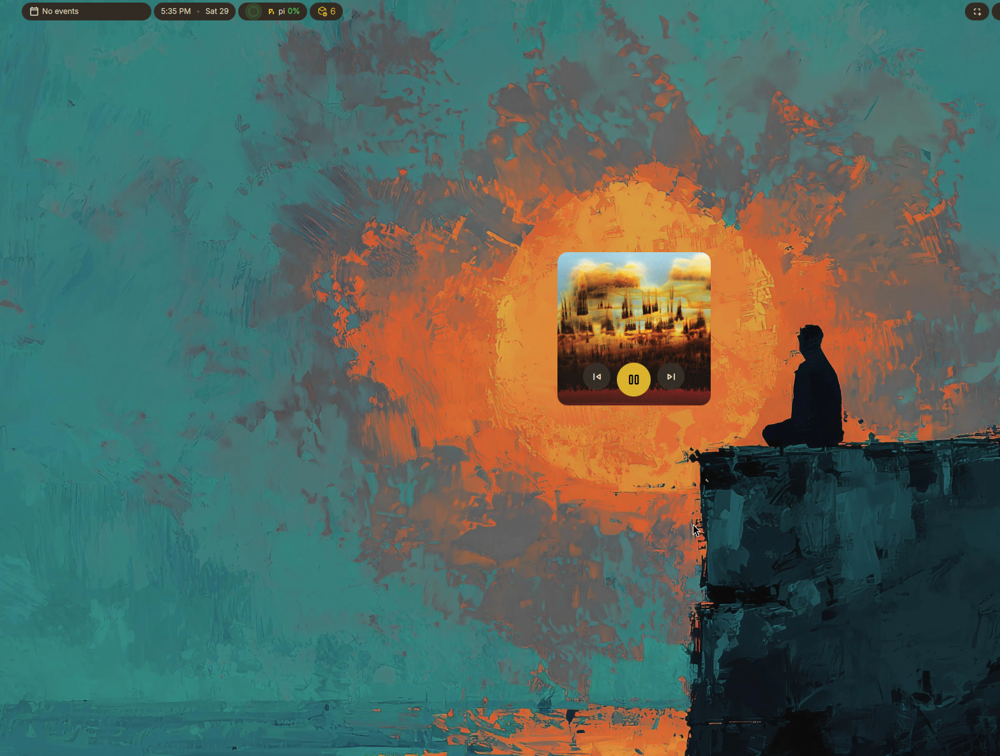

# Dux Album Widget

A Dux Shell desktop widget that shows the current track's album art
and playback controls. It talks to the same MPRIS stack Dash media uses
(`MprisController`, `TrackArtService`, `MediaAccentService`).

Any MPRIS player works: Spotify, Cider, Firefox/Brave tabs, VLC, mpv, and so on.




> Migrating from the old `dankAlbumWidget` plugin: the plugin id is now `duxAlbumWidget`, so remove `~/.config/DankMaterialShell/plugins/dankAlbumWidget` (or `~/.config/dms/plugins/dankAlbumWidget`) and re-apply your settings.

## Features

- The widget *is* the album cover: square, full-bleed MPRIS artwork
- Material previous / play-pause / next controls overlaid on the sleeve
- Art from the active MPRIS player, including remote covers and YouTube thumbnails
- Album-art accent color on the play button (when enabled in DMS media settings)
- Scroll up/down on the cover to change system volume
- Empty sleeve when nothing is playing, or hide until media starts

## Requirements

- Dux Shell (DMS) >= 2.0.0
- An MPRIS-compatible media player

## Installation

Copy the plugin into the DMS plugins directory:

```bash
git clone https://github.com/kmf/dux-album-widget.git
mkdir -p ~/.config/dms/plugins/duxAlbumWidget
cp dux-album-widget/{plugin.json,DuxAlbumWidget.qml,DuxAlbumWidgetSettings.qml} ~/.config/dms/plugins/duxAlbumWidget/
```

Then:

1. Open **Settings → Plugins**
2. Click **Scan for Plugins**
3. Enable **Dux Album Widget**
4. Open **Settings → Widgets** and place it on the desired display
5. Reload plugins if needed: `dms ipc call plugins reload duxAlbumWidget`

Right-click and drag to move. Drag the corner handle to resize.

## Configuration

Widget settings:

| Setting | Default | Description |
| --- | --- | --- |
| Hide when idle | off | Fade out when no player is active |

DMS **Settings → Media** still owns player exclusions, album-art accent, visualizer, and scroll mode. This widget follows those.
